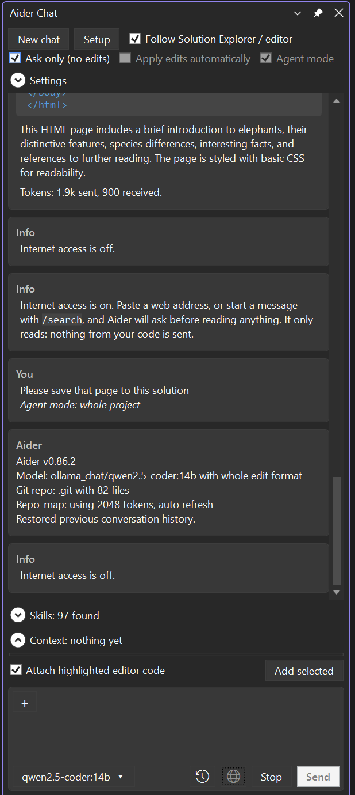

# Aider Chat for Visual Studio

A chat window inside Visual Studio for [Aider](https://aider.chat), the AI pair programmer, running on a **local coding model through Ollama**. Free to run, and your code stays on your PC.

It follows what you have selected in Solution Explorer and the editor, shows every change as a diff, and writes nothing until you press **Apply**.



## Features

- **Chat tool window** next to Solution Explorer, in your Visual Studio theme.
- **Context that follows you:** highlight a file in Solution Explorer or open one in the editor and it becomes the chat context. Highlighted editor code is attached to your message. Add files, a whole folder or the open documents with the **+** button, or type `@` to pick any file in the project.
- **Review before anything changes:** Aider works on a copy. Proposed changes appear as colour diffs, with **Apply changes** and **Discard** in a bar that stays in view. A file that changed after your request is never overwritten.
- **Agent mode:** Aider sees a map of the whole project, adds the files it needs and edits several at once. Still on a copy, still needs Apply.
- **Readable replies:** Markdown, syntax-coloured code blocks (C#, Razor, JavaScript/TypeScript, Python, SQL, shell, JSON, YAML, XML/HTML/XAML, diffs) with a copy icon, and every file shown as a link that opens File Explorer.
- **Skills:** reads `SKILL.md` skills (the Agent Skills format) and gives Aider their instructions as reference, pay-as-you-go: only when you name one with `/name` or `$name`, or mark it *always*.
- **Internet access, read-only and opt-in:** a globe icon lets Aider read web pages or search the web, but only after you allow each request. A loader shows what is being read, and a history page lists everything that was accessed, by session.
- **Setup wizard:** checks Ollama, Aider and git, and downloads or updates a coding model (Qwen2.5-Coder 1.5b to 32b, Qwen3-Coder 30b) with a progress bar. Nothing downloads until you press a button.
- **Model dropdown** beside Send, to switch between installed models.

## Requirements

- Windows 10 or 11
- Visual Studio 2022 (17.x) or Visual Studio 2026, any edition
- About 5 GB of free disk space for the default model (more for larger ones)
- [Ollama](https://ollama.com), [Aider](https://aider.chat) and [git](https://git-scm.com) (git only for Agent mode). The setup wizard in the extension can install Ollama and Aider for you.

## Install

1. Download `AiderChat-<version>.vsix` from the [Releases](../../releases) page (or build it: see below).
2. Close every Visual Studio window and double-click the `.vsix`.
3. Open Visual Studio and choose **View > Other Windows > Aider Chat**. The setup wizard opens on first run if anything is missing.

## Quick start

1. Open a project or folder in Visual Studio and open the **Aider Chat** window.
2. Click a file in Solution Explorer. It appears under *Context*.
3. Type what you want, for example *"add a null check to the constructor"*, and press **Enter**.
4. Read the diff in the reply, then press **Apply changes**.

More in the [user guide](docs/USER-GUIDE.md).

## Build from source

```powershell
.\build.ps1
```

This needs Visual Studio (2022 or later) with its MSBuild. The package is written to `artifacts\AiderChat-<version>.vsix`. See [docs/DEVELOPMENT.md](docs/DEVELOPMENT.md) for the code layout and how the pieces fit together.

## Repository layout

```
src/AiderVS/      the Visual Studio extension (C#, WPF)
docs/             user guide, development notes and images
wiki/             the pages of the GitHub wiki (publish with scripts/publish-wiki.ps1)
scripts/          aider-qwen.bat (start Aider from a terminal) and publish-wiki.ps1
build.ps1         builds the .vsix into artifacts/
AiderChat.sln     solution file
```

## How your data is handled

- Your code goes only to the local model on your PC through Ollama.
- Internet access is off by default. When it is on, each request asks first, only reads, and sends only the page address or search words, never your code.
- The extension keeps its settings, chat history and the internet history in `%LOCALAPPDATA%\AiderVS`.
