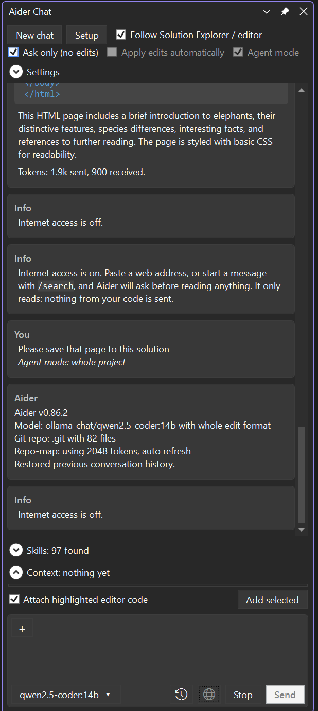

# Aider Chat for Visual Studio

A chat window inside Visual Studio for [Aider](https://aider.chat), running on a **local coding model through Ollama**. It is free to run, and your code stays on your PC.

It follows what you have selected in Solution Explorer and the editor, shows every change as a diff, and writes nothing until you press **Apply**.

## Start here

1. [[Installation]]: get the extension into Visual Studio.
2. [[Getting Started]]: the first-run setup and your first change.
3. [[The Chat Window]]: what every button and box does.

## Features

- **Context that follows you.** Highlight a file in Solution Explorer, or open one in the editor, and it becomes the chat context. Highlighted code is attached to your message. Add files, a folder or the open documents with **+**, or type `@` to pick any file.
- **Review before anything changes.** Aider works on a copy. See [[Review and Apply]].
- **Agent mode.** Aider sees a map of the whole project and can add and edit several files in one go.
- **Readable replies.** Markdown, syntax-coloured code with a copy icon, and every file is a link that opens File Explorer.
- **Skills.** Use `SKILL.md` skills on demand. See [[Skills]].
- **Internet access, read-only and opt-in.** See [[Internet Access]].
- **Setup wizard.** Checks Ollama, Aider and git and downloads a coding model for you. See [[Choosing a Model]].

## Help

- [[Troubleshooting]]
- [[Building from Source]]
